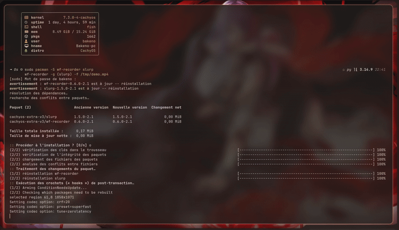

# animwall

Animated (video) wallpapers for **stock [Caelestia](https://github.com/caelestia-dots/caelestia)**, using [mpvpaper](https://github.com/GhostNaN/mpvpaper). No fork of the shell required.

> Unofficial. Not affiliated with the Caelestia project.



## How it works

Caelestia's wallpaper picker only handles images. animwall works around that:

1. For every video it makes a thumbnail named `anim-<video name>.png` in your Caelestia wallpaper folder.
2. You pick that thumbnail in Caelestia's picker (launcher, then `>wallpaper`). Caelestia uses it as a normal wallpaper, so your colour scheme follows the video.
3. A small daemon (`animwall watch`) sees that Caelestia's wallpaper changed. If it is one of the thumbnails, it plays the matching video with mpvpaper. If it is any other image, it stops the video.

So switching between animated and static wallpapers is just picking a different entry in the same picker.

## Features

- One command, `animwall`, with subcommands (`sync`, `set`, `random`, `watch`, `toggle`, `stop`, `status`, `doctor`)
- Automatic pause (the video is frozen, not just hidden):
  - on battery
  - when a fullscreen window is on the active workspace (Hyprland)
  - manual stop/start with `animwall toggle`
- Choose which monitors get the video (`OUTPUTS="DP-1 HDMI-A-1"`)
- Config file, auto-detects Caelestia's wallpaper folder from `shell.json`
- Works with mp4, webm, mkv, mov, gif
- Single instance guard, clean shutdown (no orphaned players)

## Requirements

- Caelestia (the shell and the `caelestia` CLI)
- Hyprland (other wlr-layer-shell compositors should work for playback; fullscreen pause is Hyprland-only)
- `mpvpaper`, `ffmpeg`, `inotify-tools`, `util-linux` (for `flock`)

```sh
yay -S mpvpaper
sudo pacman -S ffmpeg inotify-tools
```

**Tested with:** caelestia-shell 2.5.0, caelestia-cli 1.1.3, mpvpaper 1.9, Hyprland 0.56.2 (Arch Linux, fish). Pause on battery and on fullscreen verified on a laptop.

## Install

```sh
git clone https://github.com/Maaar31/animwall.git animwall && cd animwall
./install.sh
animwall doctor
```

`install.sh` copies the script to `~/.local/bin` and creates `~/.config/animwall/config`.
Make sure `~/.local/bin` is in your `PATH` (fish: `fish_add_path ~/.local/bin`).

## Setup

**1. Make Caelestia's picker read your wallpaper folder.** By default it reads `~/Pictures/Wallpapers`. To use another folder, set it in `~/.config/caelestia/shell.json` (the file is not created by default):

```json
{
  "paths": {
    "wallpaperDir": "/home/you/Pictures/Wallpapers"
  }
}
```

animwall reads this value automatically, so the thumbnails end up where the picker looks.

**2. Put videos in `<wallpaperDir>/anim/`**, then:

```sh
animwall sync
```

**3. Start the daemon with Hyprland.**

Lua config (`~/.config/caelestia/hypr-user.lua` with the Caelestia dots, or `hyprland.lua`):

```lua
hl.on("hyprland.start", function()
  hl.exec_cmd("animwall watch")
end)

hl.bind("SUPER + SHIFT + B", hl.dsp.exec_cmd("animwall toggle"))
```

Classic `hyprland.conf`:

```
exec-once = animwall watch
bind = SUPER SHIFT, B, exec, animwall toggle
```

If `animwall` is not found at login, use the full path (`~/.local/bin/animwall`).
Apply Lua config changes by logging out and in rather than reloading: a reload can start a second copy of your shell on some setups.

**4. Pick a thumbnail** in Caelestia: open the launcher, type `>wallpaper`, choose an `anim-*` entry.

## Usage

```
animwall sync [--prune]   make thumbnails for new videos (--prune removes orphan ones)
animwall set <video>      select a video in Caelestia and play it
animwall random           select a random video
animwall watch            daemon (start it from Hyprland)
animwall apply            one-shot sync of the player with Caelestia's current wallpaper
animwall toggle           stop the video / start it again (the thumbnail stays as a static wallpaper)
animwall stop             stop the video
animwall status           what is playing, and whether it is paused
animwall doctor           check dependencies, paths and detection
```

## Configuration

`~/.config/animwall/config` is plain bash. Every line is optional. See [`config.example`](config.example).

| Variable | Default | Meaning |
|---|---|---|
| `WALL_DIR` | from `shell.json`, else `~/Pictures/Wallpapers` | folder Caelestia's picker reads |
| `VIDEO_DIR` | `$WALL_DIR/anim` | where your videos live |
| `OUTPUTS` | `*` | monitors that get the video, e.g. `"DP-1 HDMI-A-1"` |
| `BATTERY_PAUSE` | `1` | freeze on battery |
| `FULLSCREEN_PAUSE` | `1` | freeze when the active workspace has a fullscreen window |
| `FRAME_AT` | `2` | second used for the thumbnail (it also drives Caelestia's colours) |
| `LAYER` | `bottom` | mpvpaper layer (`bottom` sits above Caelestia's background layer, below windows) |
| `MPV_OPTIONS` | `no-audio loop hwdec=auto` | options passed to mpv |

## Limitations (read this)

- It relies on Caelestia writing the current wallpaper path to `~/.local/state/caelestia/wallpaper/path.txt`. That is an internal detail and could change. `animwall doctor` tells you if the file is missing.
- Pausing uses `SIGSTOP`/`SIGCONT` on the mpvpaper process: it stops decoding and CPU/GPU work, but the process and its memory stay.
- Fullscreen detection only looks at the **active workspace** of the focused monitor (`hyprctl activeworkspace`), not at every monitor. Windows that are merely maximized do not pause the video.
- Every monitor listed in `OUTPUTS` runs its own mpvpaper instance. The same video plays on all of them: there is no per-monitor assignment of different videos yet.
- Two videos with the same file name but different extensions share one thumbnail name.
- mpvpaper is heavier than dedicated wallpaper daemons. If memory matters to you, look at other tools.

## Troubleshooting

- `animwall doctor` first.
- Picker shows no `anim-*` entries: `paths.wallpaperDir` in `shell.json` does not match `WALL_DIR` (see `doctor`), or you have not run `animwall sync`.
- Thumbnail selected but nothing plays: is `animwall watch` running? (`pgrep -af "animwall watch"`)
- Video hidden behind Caelestia's own wallpaper: keep `LAYER="bottom"` (default). It sits above Caelestia's background layer and below your windows. If it is still hidden, check the `background` section of `shell.json`.
- Picker shows no wallpapers after a long session (`caelestia shell wallpaper list` returns nothing): restart the shell with `pkill -x qs; sleep 2; caelestia shell -d`. This is a Caelestia/Quickshell quirk, not animwall.
- Using fish? Do not paste bash heredocs into it. Edit files with an editor.

## Uninstall

```sh
./uninstall.sh
```

Then remove `animwall watch` from your Hyprland config.

## License

MIT
